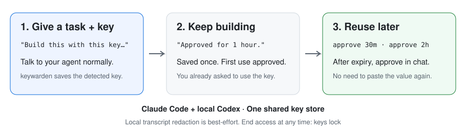

# keywarden

API keys pasted into coding agents can end up in chat history, logs, and committed files. **keywarden keeps keys in encrypted storage and gives approved programs access by name.**

Works with **Claude Code** and **local Codex**.

<p align="center"></p>

## Developer workflow

**1. Install once.** Requires Python 3. Keep this checkout: the installed command and hooks run its scripts.

```sh
git clone https://github.com/andrsnn/keywarden
cd keywarden
python3 install.py
keys setup
```

The installer adds `keys`, hooks, and a skill for both agents, plus Claude's prompt-replacement plugin. It installs the 1Password CLI through Homebrew or winget when available. If it changes your PATH, open a new terminal before `keys setup`. On Windows, use `python` instead of `python3` if needed.

Restart your agent. In **Codex**, review and trust keywarden in `/hooks`, or **Settings > Hooks** on desktop. Hooks won't run until trusted. To install for just one agent, use `python3 install.py --agent claude` or `--agent codex`.

**2. Save a key.** Copy its value, then run this in your terminal:

```sh
keys add OPENAI_API_KEY --clipboard
```

keywarden saves the value and clears the clipboard. The agent gets its name.

**3. Ask your agent to use it.** For example: `Use OPENAI_API_KEY to call the API.` The agent requests access:

```sh
keys grant OPENAI_API_KEY --for "call the API"
```

It asks you:

```text
I need OPENAI_API_KEY. Reason: call the API. Reply approve, or approve 1h.
```

**4. Reply `approve 1h`.** The message hook records your approval. The agent retries the grant, then uses `$OPENAI_API_KEY` in Bash or `$env:OPENAI_API_KEY` in PowerShell. The hook loads the value into approved shell commands and filters their output:

```text
<concealed by keywarden>
```

`approve` alone grants 12 hours by default. Reply `no` to deny access. Grants cover the named keys and are shared by local sessions on this computer.

**5. End access whenever you want.** Otherwise it expires automatically.

```sh
keys lock OPENAI_API_KEY
```

<details>
<summary><strong>What happens if I paste a key into chat?</strong></summary>

Recognized formats and explicit save requests are detected. Detection is not exhaustive; the clipboard command above keeps the value out of chat entirely.

| Agent | What happens |
| --- | --- |
| **Claude Code, plugin loaded** | Saves the detected key, replaces its value with `[NAME]`, and forwards the rewritten message. A toast says `keywarden saved your key as NAME`. |
| **Codex** | Saves the detected key and blocks the message. Clear the value from the input, then resend your request using the saved name. |
| **Claude Code, plugin unavailable** | Uses the same save-and-block fallback. |

For a newly saved key named `OPENAI_API_KEY`, the Codex hook's exact reason is:

```text
Saved your key as OPENAI_API_KEY. This is keywarden working, not an error: it held your message back on purpose, so Codex never saw the key. Clear the key from the input box, then ask Codex to use OPENAI_API_KEY. To change the name, ask Codex to rename it.
```

Blocked messages may still be logged locally. keywarden attempts to scrub the supplied transcript in the background. If a real key already reached the model provider, rotate it; local cleanup cannot undo that exposure. `keys rescue --save --redact` searches **Claude's** local logs, not Codex's.

</details>

## Storage backends

Both agents use the same store. `keys setup` chooses 1Password if connected, otherwise the OS store.

| Backend | Best for | Setup |
| --- | --- | --- |
| **1Password** | Synced keys and shared vaults. macOS and Windows. | Connect the app and CLI, then `keys setup 1password`. |
| **macOS Keychain** | Local keys without another account. | `keys setup local` |
| **Windows Credential Manager** | Local keys without another account. | `keys setup local` |

For 1Password, enable **Settings > Developer > Integrate with 1Password CLI** in its app. keywarden creates an **Agent Keys** vault. Supply another name with `keys setup 1password "Vault Name"`.

Use `keys switch 1password` or `keys switch local` to copy keys and change stores with approval. Old copies remain until you delete them.

## Why this helps

| Protection | Why it matters |
| --- | --- |
| **Encrypted storage** | Values stay in 1Password or the OS key store instead of plaintext `.env` files and source code. |
| **Names in the conversation** | The agent can find and reuse saved keys without asking you to paste their values. |
| **Expiring approval** | Your chat reply, phone passkey, or local biometric check grants access to selected keys. `keys lock` ends it early. |
| **Exposure checks** | Hooks block common leaks such as `printenv`, `echo $API_KEY`, reading `.env`, and inserting detected keys into commands or file edits. |
| **Filtered output** | Hooked commands mask key values and their base64 forms before the agent reads their output. `keys run` masks literal values. |
| **Audit trail** | `~/.agent-keys/use.log` records grant requests and approvals with names, reasons, and times. |

**The boundary is your computer.** These hooks are guardrails, not a sandbox: a determined command or another program running as you can bypass them or access your store. Approved processes receive real values. Use these integrations in local sessions where the scripts and key store are available; cloud agents don't inherit them.

With 1Password, `keys strict on` disables local cached copies and reads fresh through 1Password's authentication. Otherwise, approved values are cached in the OS store; expired copies are cleared on the next cache check or `keys lock`. 1Password decides when to prompt for authentication.

<details>
<summary><strong>More commands and approval options</strong></summary>

| Command | Purpose |
| --- | --- |
| `keys list` / `keys status` | Find saved names and see current grants. |
| `keys add NAME` | Save via hidden typing or piped input. Also accepts `--from-env VAR`. |
| `keys import FILE.env` | Save keys from an existing file. |
| `keys note NAME "description"` | Tell agents what a key is for. |
| `keys rename OLD NEW` / `keys remove NAME` | Rename or delete with approval. |
| `keys run NAME -- command` | Give selected keys to one program, including outside hooked shells. |
| `keys ref NAME` | Make a `NAME=keys:NAME` reference for `.env.tpl`. |
| `keys lock` | End every grant. |
| `keys approvals chat` | Approve in chat; the default. |
| `keys phone` / `keys phone test` | Set up and test phone approval over Tailscale with a passkey. |
| `keys approvals phone` | Request phone or local biometric approval. |
| `keys protect NAME` | Require phone or local biometric approval for a key. |
| `keys approvals off` | Allow new grants without asking; changing this setting needs approval. |
| `keys strict on` | Read fresh from 1Password without caching. Turning it off needs approval. |

Phone approval lets you choose the duration. Local Touch ID / Windows Hello approval defaults to 60 minutes; change it with `keys setup --grant-minutes N`.

To remove the integrations and command, run `python3 install.py --uninstall`. Saved keys remain in their store. `--agent claude` or `--agent codex` removes only that integration and keeps the shared command.

</details>

## Run the tests

```sh
python3 test_all.py
```

The suite checks detection, save/approve/deny/lock flows, both storage backends, phone/passkey verification, Claude and Codex hook contracts, installer updates, and output masking. When the CLIs are installed, native smoke tests verify prompt replacement/blocking against a local model stub. No real model API is called.

Tests use synthetic keys, a fake 1Password CLI, temporary settings, and separate OS key-store namespaces. Storage tests require macOS or Windows; phone tests need `cryptography`, and shell-filter tests need Bash. Real 1Password authentication, Windows Hello, and phone hardware still need testing on those devices.

Hook integration references: [Codex](https://learn.chatgpt.com/docs/hooks), [Claude Code](https://code.claude.com/docs/en/hooks).
