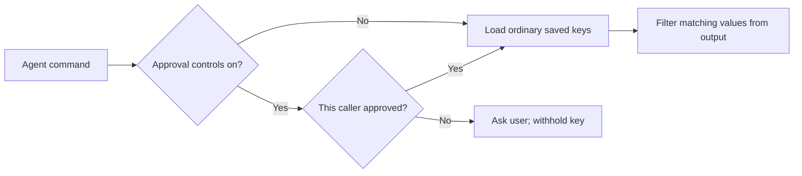

# keywarden

Coding agents can scatter API keys across project files and chat history. **keywarden keeps keys in one encrypted store and lets Claude Code and Codex use them by name.**

Saved keys work automatically by default. Optional approval controls give you separate access for each session and subagent.

## Features

- 🔁 **One store, both agents.** Save a key with Claude, use it from Codex—or the other way around.
- 💬 **Keep building.** Give your agent a task and a key. It saves the key and gets on with the work.
- 🧷 **Optional approval and session binding.** Off by default. Turn it on for separate approval of every agent session and subagent.
- 🔐 **Encrypted storage.** macOS Keychain or Windows Credential Manager, with optional 1Password support.
- 🧹 **Fewer plaintext copies.** Saved-name references, output filtering, and best-effort local transcript cleanup.

<p align="center"></p>

## The default workflow

**1. You're building something. Give your agent the task and key.**

```text
You: Build an AI chat app with this OpenAI API key: sk-…
```

**2. keywarden saves it. The agent keeps working.**

```text
Agent: Saved as OPENAI_API_KEY. Ready for Claude Code, Codex, and their subagents.
```

**3. Reuse it next time, in either agent.** No need to paste the value again or type `approve`. The agent finds the saved name and programs receive the value through environment variables.

With approval controls off, ordinary saved keys are available automatically to all local agent sessions and subagents using this store. Access is not scoped to a project. Explicitly protected keys retain their extra approval check.

## Install once

Requires Python 3 and macOS or Windows. Keep the checkout: the installed command and hooks run its scripts.

```sh
git clone https://github.com/andrsnn/keywarden
cd keywarden
python3 install.py
keys setup local
```

Restart your agent. In **Codex**, review and trust keywarden in `/hooks`, or **Settings > Hooks** on desktop. If the installer changes your PATH, open a new terminal before setup. On Windows, use `python` if `python3` isn't available.

The installer adds the command, hooks, and skill for both agents, plus Claude's prompt-replacement plugin. Use `--agent claude` or `--agent codex` to install one integration. Existing explicit `chat` or `phone` settings are preserved; run `keys approvals` to see your mode.

## Optional: approvals and session binding

Want more control? Turn on approval for each agent session **and each subagent**:

```sh
keys approvals on
```

`keys approvals chat` is an alias. Enabling the control clears grants created in automatic mode, so the new boundary takes effect immediately.

| Access | Off — default | On |
| --- | --- | --- |
| Use an ordinary saved key | Automatic. | Requires that caller's approval. |
| Open another Claude or Codex session | Works automatically. | New session asks for its own access. |
| Start a subagent | Works automatically. | Subagent asks separately, even if its parent is approved. |
| Give a session a key | Saved and available to other callers. | Saved; that session gets access for 12 hours by default. Other callers ask. |

With the control on, a caller that needs access asks:

```text
Agent: Use OPENAI_API_KEY for this task?
       Reply approve, approve 30m, approve 2h, or no.

You: approve 30m
```

`approve` alone grants one hour. Giving a session a key directly grants that session 12 hours (`paste_minutes` in config.json); explicitly protected keys and phone-required mode still require their extra check.

To turn the control off again:

```sh
keys approvals off
```

Disabling an enabled control requires confirmation. `keys lock` clears grants: with controls on, an agent clears its own grants and your terminal clears everyone's. **With controls off, ordinary keys become available again automatically; `keys lock` does not revoke that automatic access.**

### How the optional security layer works

**The store is shared; approvals belong to individual callers.** A caller is an agent session or one of its subagents.



When controls are on:

1. **Identify the caller.** Hooks use the session and subagent IDs supplied by Claude Code and Codex. A caller token identifies commands from that session or subagent.
2. **Check its grant.** keywarden checks the key name and expiry against that caller's grants. Approval of Claude session A does not approve its subagent, Claude session B, or a Codex session.
3. **Load approved values.** Approved keys enter the program's environment. Unapproved values are withheld until the user approves. A subagent's request can be answered in its parent session's chat; an unrelated session's reply does not approve it.
4. **Expire or lock.** Expiry and `keys lock` stop future loading under that grant. Common attempts to change or clear the caller token are blocked.

This is hook-enforced **session binding**, not OS process isolation. Caller tokens also support bookkeeping and protected keys when controls are off; they do not restrict ordinary key access in that mode. Programs run with your account, child processes can inherit values, and locking cannot erase a value a running program already received.

## Protections that stay on in both modes

- **Encrypted storage:** values live in the selected key store, rather than plaintext project files.
- **Exposure checks:** hooks block common attempts to print keys, read secret files, or write detected values into commands and files.
- **Filtered output:** hooked commands mask matching values and their base64 forms as `<concealed by keywarden>`. `keys run` masks literal values.
- **Local cleanup:** a helper attempts transcript redaction in the background without replacing the live file.

**Pasting has limits.** Claude's plugin replaces detected values before forwarding to the model. Codex and Claude without the plugin continue with the original prompt, so the initial paste can reach the model and local history. Redaction cannot erase in-memory context, provider copies, backups, or every local log. Detection and filtering are guardrails; they cannot stop malicious code running as you.

To keep the value out of chat entirely, copy it and run `keys add NAME --clipboard` in your terminal. That saves it and clears the clipboard.

## Other optional layers

| Layer | Purpose | Status |
| --- | --- | --- |
| **1Password** | Synced keys and shared vaults. Connect its app and CLI, then run `keys setup 1password`. When approvals are enabled, unlocking 1Password can approve a caller; unsuccessful unlocks fall back to chat. Set `"unlock_1password": false` in config.json to use chat approval. | Fake CLI tested; real vault authentication and unlock prompts unverified. |
| **Phone / biometrics** | `keys approvals phone` requires phone or local biometric approval for each caller. Set up the phone with `keys phone`. | Signature logic tested; real phone, Touch ID, and Windows Hello unverified. |
| **Protected keys** | `keys protect NAME` keeps an extra approval check on one key, even when ordinary approval controls are off. | Removing protection requires approval. |

With 1Password, `keys strict on` disables local caching and reads fresh through its authentication. This is independent of session binding; 1Password controls when it prompts.

<details>
<summary><strong>Useful commands</strong></summary>

| Command | Purpose |
| --- | --- |
| `keys list` / `keys status` | Find saved names and see access mode and grants. |
| `keys approvals` / `on` / `off` | Inspect, enable, or disable the optional approval layer. |
| `keys note NAME "description"` | Tell agents what a key is for. |
| `keys add NAME --clipboard` | Save a copied key without pasting into chat. |
| `keys import FILE.env` | Save keys from an existing file. |
| `keys run NAME -- command` | Pass selected keys to a program; asks only when the configured policy requires it. |
| `keys rename OLD NEW` / `keys remove NAME` | Rename or delete through the configured approval policy. |
| `keys switch 1password` / `keys switch local` | Copy keys to another store and select it. Old copies remain. |
| `keys rescue --save --redact` | Save recognized keys and scrub Claude's local logs; does not search Codex logs. |

Access requests and grants are recorded in `~/.agent-keys/use.log`. Non-strict 1Password reads use OS-store cache copies while grants are active. In automatic mode, access is renewed without asking; enabling approval controls clears previous automatic grants and cached copies.

Uninstall with `python3 install.py --uninstall`. Saved keys stay in their store.

</details>

## Tests

```sh
python3 test_all.py
```

Tests cover default automatic access, enabling/disabling controls, separate session and subagent approvals, both agents' native hooks, storage, output masking, and transcript cleanup. Native tests use synthetic keys and a local model stub; no real model API is called. Real 1Password authentication, Windows, and approval hardware remain unverified. Phone tests need `cryptography`; shell tests need Bash. `python3 e2e_claude.py` separately tests the enabled control with real Claude sessions using your account.

Hook references: [Codex](https://learn.chatgpt.com/docs/hooks), [Claude Code](https://code.claude.com/docs/en/hooks).
