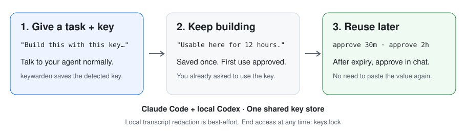
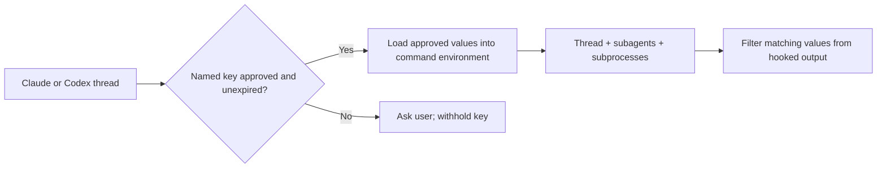

# keywarden

Coding agents can scatter API keys across files and chat history—or reach for saved credentials you never intended a long-running task to use. **keywarden stores keys once and lets you approve specific keys for a Claude Code or Codex thread.**

**Approvals are on by default.** One approval covers the thread, its subagents, and subprocesses for a limited time. Other threads ask separately.

## Features

- 🔁 **One store, both agents.** Save a key with Claude, use it from Codex—or the other way around. Each thread gets its own approval.
- 🌙 **Set boundaries before an overnight run.** Tell Nightshift which keys the task needs and how long it may use them. Other saved keys stay unavailable until approved.
- 🧵 **Approve once for the whole thread.** Subagents and subprocesses share the approved keys and expiry.
- 👆 **Approve with Touch ID.** Optional on a Mac: `keys touchid on` turns a key request into a fingerprint tap instead of a chat reply. Windows Hello works the same way on Windows, or you can plug in your own approver. [How it works](#approve-with-touch-id-optional).
- ⏳ **Access expires.** Long context, compaction, and resuming a thread do not renew an expired approval.
- 🔐 **Encrypted storage.** macOS Keychain or Windows Credential Manager, with optional 1Password support.
- 🧹 **Fewer plaintext copies.** Saved-name references, output filtering, and best-effort local transcript cleanup.

<p align="center"></p>

## The developer workflow

**1. Save a key once.** Give your agent a task and a new key:

```text
You: Build an AI chat app with this OpenAI API key: sk-…

Agent: Saved OPENAI_API_KEY to keywarden. Approved for this thread (12 hours).
```

Giving a thread a new key is consent to use it, including in its subagents and subprocesses. No second `approve` is needed. To keep the value out of chat entirely, copy it and run `keys add OPENAI_API_KEY --clipboard` in your terminal instead.

**2. Approve saved keys up front for a long run.** Start a new Claude or Codex thread with an explicit line naming the keys and duration:

```text
You: You'll need these keys: OPENAI_API_KEY, GITHUB_TOKEN for 8h
     Build the integration and keep working with Nightshift overnight.

Agent: Approved OPENAI_API_KEY and GITHUB_TOKEN for this thread for 8 hours,
       including its subagents and subprocesses.
```

`approve OPENAI_API_KEY GITHUB_TOKEN for 8h` also works. Put the approval on its own line and use saved names. Without a duration, named approval lasts **one hour**. Repeating a named approval with a different duration sets its new expiry.

**3. The agent works within that access.** Programs receive approved values through environment variables. A newly spawned helper shares the thread's approval. Another Claude/Codex thread—or a task needing a different saved key—must ask:

```text
Agent: Use STRIPE_SECRET_KEY for this task?
       Reply approve, approve 30m, approve 2h, or no.

You: approve 30m
```

A language model reads your reply, not a word list: Claude Haiku, through your own `claude` login, decides whether it says yes, no or neither. So any clear yes works, in your own words, with typos or other topics mixed in: "ok, go ahead", "GO", "aprove", "stop using the laptop, and I approve using a key". If no model can be reached, keywarden falls back to simple word matching. A clear no, like "no", "hold off" or "not that key", turns it down. A reply that doesn't answer, like a question, leaves the request waiting.

**What a chat yes is for.** It is not a security check: anything that can type into the chat can type "yes". It gives you two things: you see which keys each agent is using, and access runs out, so a long task doesn't hold a key forever. For a real check, turn on Touch ID or Windows Hello (`keys touchid on`) or phone approval (`keys approvals phone`): then a key request waits for your fingerprint or a tap on your phone, which an agent or a prompt in a web page can't fake. A third option is a code from an authenticator app (`keys approvals totp`): a key request then waits until you type the app's current 6-digit code in the chat.

**This helps with long context threads:** remembering that a key exists does not authorize its use. After compaction or resume, keywarden checks the current approval and expiry again. If an overnight task drifts into work needing another credential, it has to get your permission. This limits key access; it does not approve individual API calls or control how an approved key is used.

## Install once

Requires Python 3 and macOS or Windows. Keep the checkout: the installed command and hooks run its scripts.

```sh
git clone https://github.com/andrsnn/keywarden
cd keywarden
python3 install.py
keys setup local
```

On a Mac, run `keys touchid on` too if you'd rather approve keys with Touch ID than by replying in the chat.

Restart your agent. In **Codex**, review and trust keywarden in `/hooks`, or **Settings > Hooks** on desktop. If the installer changes your PATH, open a new terminal before setup. On Windows, use `python` if `python3` isn't available.

The installer adds the command, hooks, and skill for both agents, plus Claude's prompt-replacement plugin. Use `--agent claude` or `--agent codex` to install one integration. **Existing explicit approval settings are preserved.** If you previously turned approvals off, run `keys approvals on` to enable them. This also clears grants created while approvals were off. Upgrades with no explicit setting adopt the new approval-on default and clear old automatic grants.

<details>
<summary><strong>Why isn't Claude replacing a pasted key?</strong></summary>

The prompt-replacement plugin must be installed, enabled, and loaded in the running Claude session. Run `python3 install.py --agent claude`, then fully restart Claude Code. Installing only the Python hooks does not load the replacement plugin.

Replacement is a literal string edit in the plugin's JavaScript runtime. For storage, it tries the installed `keys` command, available shells (Bash/Zsh/sh on macOS/Linux; PowerShell or cmd on Windows), then Python launchers. The storage backend still requires Python 3; shell launchers do not replace that dependency. A missing or stale cached Python path no longer stops discovery.

If the plugin cannot save and replace safely, it blocks the message with an actionable error. Without the plugin, the command-hook fallback still saves the key, but the original paste can reach the provider. That path shows a short privacy note once per session. Save confirmations appear in the agent's normal reply, with a toast when the plugin is loaded.

</details>

## How the security layer works

**Two layers.** Chat approval gives you visibility and expiry: which keys a thread uses, and for how long. The real gate is the second factor: Touch ID, Windows Hello, a phone tap, or the 6-digit code from an authenticator app. Turn one on for keys that matter.

**Storage is shared. Approval is scoped to a thread and specific key names.** Claude and Codex see the same saved names, but approval in one thread does not approve another.



1. **Identify the thread.** Hooks use the parent session ID supplied by Claude Code or Codex. Main-agent and subagent commands get the same caller token; subprocesses inherit it and the environment.
2. **Check names and expiry.** keywarden reads current grants from disk. An old message in a long context, a remembered key name, or compaction does not create or renew access.
3. **Load approved values.** Hooked commands receive the approved keys. Unapproved keys remain in the store. Delegation shares the approved set and its expiry; it does not expand that set or extend the timer.
4. **Expire or lock.** Expiry stops future loading. `keys lock` from the thread or a subagent clears that whole thread's grants; your terminal can clear everyone's. Common attempts to change or clear the caller token are blocked.

This is hook-enforced **thread binding**, not OS process isolation. Programs run with your account. Child processes can inherit values, and expiry or locking cannot erase credentials a running process already received. A separately launched Claude/Codex thread needs separate approval. Access is not scoped to a project or API endpoint, and these guardrails cannot stop malicious code running as you.

### Protections that stay on

- **Encrypted storage:** values live in the selected key store, rather than plaintext project files.
- **Exposure checks:** hooks block common attempts to print keys, read secret files, or write detected values into commands and files.
- **Filtered output:** hooked commands mask matching values and their base64 forms as `<concealed by keywarden>`. `keys run` masks literal values.
- **Local cleanup:** a helper attempts transcript redaction in the background without replacing the live file.

**Pasting has limits.** Claude's plugin replaces detected values before forwarding to the model. Codex and Claude without the plugin continue with the original prompt, so the initial paste can reach the model and local history. Redaction cannot erase in-memory context, provider copies, backups, or every local log. Use `keys add NAME --clipboard` to avoid pasting values into chat.

**Attached key files.** When you attach a file with `@` and it holds a private key block or a key in a known format, keywarden saves the key under the file's name and keeps the file out of the chat. With Claude's plugin, the message goes on with `[NAME]` in place of the file. Without the plugin, the message is stopped, because Claude Code reads the file before any hook runs. keywarden also deletes Claude's copy of an uploaded file, but leaves your own files alone.

## Supported backends and optional controls

| Backend / layer | Purpose | Status |
| --- | --- | --- |
| **Local OS store — default** | macOS Keychain or Windows Credential Manager. Both agents use the same store on this computer. | macOS tested; real Windows execution unverified. |
| **1Password** | Synced keys and shared vaults. Run `keys setup 1password`. Unlocking 1Password can approve a thread; unsuccessful unlocks fall back to chat. Set `"unlock_1password": false` in config.json to use chat approval. | Fake CLI tested; real authentication and unlock prompts unverified. |
| **Phone / biometrics** | `keys approvals phone` requires phone or local biometric approval. Set up the phone with `keys phone`. | Signature logic tested; real phone, Touch ID, and Windows Hello unverified. |
| **Touch ID / Windows Hello** | `keys touchid on` approves chat requests with a tap on this computer. Off by default. See below. | Fake approver tested on Windows and macOS. The Swift helper builds and times out on macOS CI. A real fingerprint tap is unverified. |
| **Authenticator codes (TOTP)** | `keys approvals totp` makes each key request wait for the 6-digit code from your authenticator app. Off by default. See below. | Tested with the RFC 6238 test codes and a test key store. Not yet tried with a real authenticator app. |
| **1Password references** | `keys add NAME --op op://Vault/Item/field` saves the reference. keywarden reads the value with `op` each time the key is used and never stores it. | Fake CLI tested; real 1Password unverified. |
| **Protected keys** | `keys protect NAME` keeps an extra approval check. Pasting or naming it does not bypass that check. | Removing protection requires approval. |

With 1Password, `keys strict on` disables local caching and reads fresh through its authentication. This is independent of thread approval; 1Password controls when it prompts.

Approval is on by default (`keys approvals on`, also called `chat`). You can explicitly disable it with `keys approvals off`, which requires confirmation. When off, ordinary keys become available automatically to all local threads and subagents. **`keys lock` does not revoke automatic access in that mode.** Protected keys retain their extra checks.

### Approve with Touch ID (optional)

On a Mac you can approve key requests with Touch ID instead of replying in the chat:

```sh
keys touchid on        # asks for one tap now to turn it on
keys touchid test      # try it
keys touchid off       # back to replying in the chat
```

When an agent runs `keys grant`, the Touch ID prompt opens on your Mac with the key names and the reason. A tap approves those keys for that thread. Cancel denies them. If nobody taps within 60 seconds (`keys touchid timeout SECONDS` changes this), or Touch ID can't ask, the agent asks in the chat as usual. On Windows the same commands use Windows Hello.

Turning approval settings off, unprotecting a key and leaving strict mode still ask in the chat or on your phone, never with this tap.

You can plug in your own approver, such as a hardware key script:

```sh
keys touchid use command -- /path/to/approve-prog --flag
```

keywarden runs the program with the request as its last argument and the timeout in seconds in `AGENT_KEYS_TIMEOUT`. The last line it prints decides: `Verified` approves, `Timeout` or a line starting with `unavailable` sends the request to the chat, and anything else denies it. With `--check` it should print `available`. Plugging in a program asks for your OK in the chat first, because that program can approve every key. Python code can add an approver with `local_auth.register(name, approver)`.

### Approve with an authenticator code (optional)

You can make key requests wait for a code from an authenticator app, like Google Authenticator, 1Password or Authy:

```sh
keys totp setup        # shows a QR code (or a key to type in), then asks for the first code
keys totp test         # type a code and see if it's right
keys approvals totp    # from now on, key requests wait for a code
```

Run `keys totp setup` and `keys totp test` in your own terminal. They refuse to run from an agent's command. The secret is saved in this computer's key store, not in a file.

When an agent asks for a key, it asks you for the code:

```text
Agent: I need STRIPE_SECRET_KEY to test the refund.
       Reply with the 6-digit code from your authenticator app.

You: 492 017 2h
```

The code approves the waiting request for one hour, or for the time you add, like `2h`. Each code works once. keywarden accepts the current code and the one just before or after it, in case a clock is a little off. If you type a wrong or used code, the agent tells you and the request keeps waiting. In this mode a "yes" without a code doesn't approve anything, and neither does an `approve NAME for 8h` line or pasting a key. A "no" still turns a request down. Protected keys take the code too. If you run `keys grant` in your own terminal, it asks for the code right there.

To go back to replying yes in the chat, run `keys approvals on`. That asks for a code too.

### Keep a key in 1Password and save only the reference

```sh
keys add STRIPE_SECRET_KEY --op "op://Dev/Stripe/credential"
```

keywarden saves the path, not the key. Each time the key is used, through `keys run` or an agent's command, keywarden reads the value with the 1Password CLI (`op`) and doesn't keep it. `keys list` shows the path. This works with either store. In 1Password, open the item, click the field's menu and pick Copy Secret Reference to get the path. If `op` isn't installed or you're signed out of 1Password, keywarden says so and only that key fails. Approval works the same as for any other key.

<details>
<summary><strong>Useful commands</strong></summary>

| Command | Purpose |
| --- | --- |
| `keys list` / `keys status` | Find saved names and see access mode and grants. |
| `keys approvals` / `on` / `off` | Inspect, enable, or disable thread approval. |
| `keys touchid on` / `off` / `test` | Approve requests with Touch ID (Windows Hello on Windows) instead of the chat. |
| `keys totp setup` / `test`, `keys approvals totp` | Approve requests with the 6-digit code from an authenticator app. |
| `keys add NAME --op op://Vault/Item/field` | Save a 1Password reference. The value is read from 1Password each time the key is used. |
| `keys lock [NAME ...]` | Revoke future loading for this thread and its helpers; from your terminal, revoke for all threads. |
| `keys note NAME "description"` | Tell agents what a key is for. |
| `keys add NAME --clipboard` | Save a copied key without pasting into chat. |
| `keys import FILE.env` | Save every key in an existing file. |
| `keys import FILE.env --only NAME1,NAME2` | Save only those keys from the file. If a different value is already saved under a name, keywarden keeps it unless you add `--replace`. |
| `keys grant NAME --for "why"` | Ask for a key. If NAME isn't saved, keywarden looks for it in .env files on disk, saves it and says which file it came from. Set `AGENT_KEYS_ENV_DIRS` to choose the folders it looks in. |
| `keys run NAME -- command` | Pass selected keys to a program under the configured approval policy. |
| `keys rename OLD NEW` / `keys remove NAME` | Rename or delete through the configured approval policy. |
| `keys switch 1password` / `keys switch local` | Copy keys to another store and select it. Old copies remain. |
| `keys rescue --save --redact` | Save recognized keys, including private key blocks, and scrub Claude's local logs; does not search Codex logs. |

Access requests and grants are recorded in `~/.agent-keys/use.log`. Non-strict 1Password reads use OS-store cache copies while grants are active. Enabling approval clears automatic grants and cached copies.

Uninstall with `python3 install.py --uninstall`. Saved keys stay in their store.

</details>

## Tests

```sh
python3 test_all.py
```

Tests cover authenticator codes and 1Password references, approval-on defaults, up-front named consent, thread/subagent sharing, subprocess inheritance, unrelated-thread isolation, expiry and lock, both agents' native hooks, storage, output masking, and transcript cleanup. Native tests use synthetic keys and a local model stub; no real model API is called. Plugin tests cover literal replacement, Unicode, multiline/repeated values, launcher selection, and safe failure; they use Node.js 22.6+ when available. Shell selection on Windows is mocked; real Windows, 1Password authentication, and approval hardware remain unverified. Phone tests need `cryptography`; shell tests need Bash. `python3 e2e_claude.py` separately tests real Claude sessions using your account.

Hook references: [Codex](https://learn.chatgpt.com/docs/hooks), [Claude Code](https://code.claude.com/docs/en/hooks).
